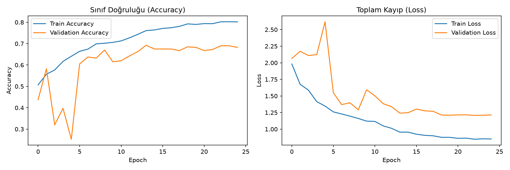
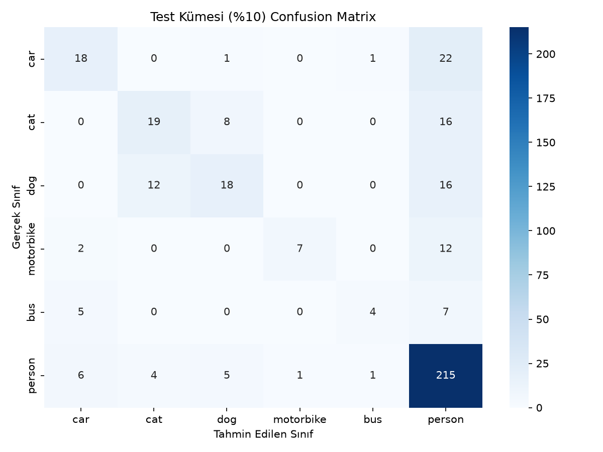
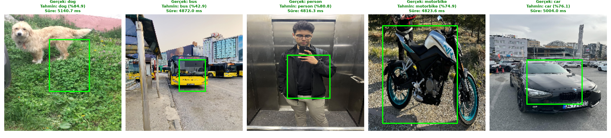

# COMPUTER VISION – DERİN ÖĞRENME UYGULAMASI PROJE RAPORU

---

## 1. Ödevin Amacı
Bu çalışmanın amacı, açık kaynaklı **Pascal VOC 2012** veri setini kullanarak çok sınıflı bir **Nesne Tespiti ve Konumlandırma (Object Detection & Localization)** problemi için uçtan uca bir Evrişimli Sinir Ağı (**CNN**) modeli geliştirmek, modelin başarımını çeşitli sınıflandırma ve nesne tespiti metrikleriyle değerlendirmek, eğitilen modeli **Gradio** tabanlı interaktif bir web uygulamasına dönüştürmek ve telefonla çekilen gerçek dünya fotoğrafları üzerinde test etmektir.

---

## 2. Görev (Task)
* **Seçilen Görev:** Nesne Tespiti (Object Detection – Sınıf Tahmini + Bounding Box Koordinat Regresyonu).
* Model, girdi olarak verilen görüntüdeki ana nesnenin hangi sınıfa ait olduğunu bulmakta ve nesnenin etrafına sınır kutusu (**Bounding Box**) çizmektedir.

---

## 3. Model Mimarisi (CNN)
Problemin çözümü için **TensorFlow / Keras** kullanılarak 5 evrişim bloğuna ve çift çıkışlı (multi-output) yapıya sahip özel bir **CNN** mimarisi (`model_mimarisi.py`) tasarlanmıştır:

1. **Özellik Çıkarıcı Omurga (Feature Extractor):**
   * 5 adet ardışık `Conv2D` katmanı (sırasıyla `32, 64, 128, 256, 512` filtre, `3x3` çekirdek boyutu, `same` dolgulama ve `ReLU` aktivasyonu).
   * Her evrişim katmanından sonra eğitimi stabilize etmek için `BatchNormalization` ve uzamsal boyutu yarıya indirmek için `MaxPooling2D(2x2)` uygulanmıştır.
   * Son evrişim bloğunun ardından özellik haritalarını özetlemek için `GlobalAveragePooling2D` katmanı kullanılmıştır.
2. **Çift Çıkışlı Başlık (Dual-Head Output):**
   * **Sınıf Tahmin Dalı (`class_output`):** `Dense(256, ReLU)` -> `Dropout(0.4)` -> `Dense(6, Softmax)` yapısı ile görüntünün 6 sınıftan hangisine ait olduğunu olasılıksal olarak tahmin eder.
   * **Kutu Koordinat Dalı (`bbox_output`):** `Dense(128, ReLU)` -> `Dense(64, ReLU)` -> `Dense(4, Sigmoid)` yapısı ile nesnenin `[xmin, ymin, xmax, ymax]` koordinatlarını `[0, 1]` aralığında tahmin eder.

---

## 4. Veri Seti (Dataset)
* **Kullanılan Veri Seti:** Pascal VOC 2012
* **Veri Seti Linki:** https://www.kaggle.com/datasets/huanghanchina/pascal-voc-2012
* **Hedef Sınıflar (6 Sınıf):** Araba (`car`), Kedi (`cat`), Köpek (`dog`), Motosiklet (`motorbike`), Otobüs (`bus`) ve İnsan (`person`).
* **Veri Ön İşleme ve Küme Ayrımı (%80 - %10 - %10):**
  * XML etiket dosyaları (`Annotations`) okunarak her görüntüdeki nesnenin sınıf etiketi ve sınır kutusu (`xmin, ymin, xmax, ymax`) koordinatları `[0, 1]` aralığına normalize edilmiştir.
  * Tüm görüntüler `224 x 224 x 3` boyutuna getirilmiş ve piksel değerleri `[0, 1]` aralığına ölçeklendirilmiştir.
  * Toplam **4000** görüntü, sınıf dağılımı korunarak (stratified split) şu şekilde ayrılmıştır:
    * **%80 Eğitim (Training) Kümesi (3200 görüntü):** Modelin ağırlıklarının öğrenilmesi için kullanılmıştır.
    * **%10 Doğrulama (Validation) Kümesi (400 görüntü):** Eğitim sırasında doğrulama kaybını izlemek ve aşırı öğrenmeyi (overfitting) önlemek için kullanılmıştır.
    * **%10 Test Kümesi (400 görüntü):** Eğitimde hiç kullanılmamış olup, modelin nihai performansını ölçmek için ayrılmıştır.

---

## 5. Model Ayarları ve Eğitim
* **Optimizer:** `Adam (learning_rate = 0.001)`. Adaptif öğrenme oranı sayesinde hem sınıflandırma hem de koordinat regresyonunda hızlı ve kararlı yakınsama sağladığı için tercih edilmiştir.
* **Aktivasyon / Çıkış Fonksiyonları:**
  * Gizli katmanlarda doğrusal olmayan özellikleri öğrenmek için `ReLU`,
  * Sınıf çıkışında olasılık dağılımı elde etmek için `Softmax`,
  * Bounding Box çıkışında ise koordinatlar `[0, 1]` aralığında normalize edildiği için `Sigmoid` seçilmiştir.
* **Loss (Kayıp) Fonksiyonu:** Sınıf tahmini için `Categorical Crossentropy`, Bounding Box regresyonu için `MSE (Mean Squared Error)` kullanılmıştır (`loss_weights = [1.0, 10.0]`).
* **Hiperparametreler:** `Input Size = 224x224x3`, `Batch Size = 32`, `Epochs = 25`, `Dropout = 0.4`, `EarlyStopping (patience = 5)`, `ReduceLROnPlateau (factor = 0.5, patience = 2)`.

### Eğitim ve Doğrulama Grafikleri

---

## 6. Performans Değerlendirmesi (%10 Test Kümesi Sonuçları)
Eğitilen model, eğitim aşamasında hiç görmediği **%10 Test Kümesi (400 görüntü)** üzerinde değerlendirilmiş ve aşağıdaki sonuçlar elde edilmiştir:

* **Ortalama IoU (Mean IoU):** `0.3243`
* **Test Accuracy (Doğruluk):** `0.7025 (%70.25)`
* **Test Precision (Kesinlik):** `0.6896`
* **Test Recall (Duyarlılık):** `0.7025`
* **Test F1-Score:** `0.6767`
* **Toplam Eğitim Süresi:** `845.40 saniye (14.09 dakika)`
* **Ortalama Tahmin Süresi (Inference Time):** `8.09 ms / görüntü`

### Test Kümesi Karmaşıklık Matrisi (Confusion Matrix)

---

## 7. Uygulama (Deployment – Gradio)
Eğitilen model (`cnn_object_detector.keras`), **Gradio** kütüphanesi (`uygulama_app.py`) kullanılarak çalışan bir web uygulamasına dönüştürülmüştür. Kullanıcı tarayıcı üzerinden sürükle-bırak yöntemiyle fotoğraf yükleyebilmekte; uygulama ise tespit edilen nesnenin etrafına **Bounding Box** çizmekte, sınıf olasılıklarını ve **tahmin süresini (ms)** göstermektedir.

---

## 8. Gerçek Görüntülerle Test ve Değerlendirme (5 Telefon Fotoğrafı)
Modelin gerçek dünya performansını ölçmek amacıyla cep telefonu ile 5 farklı fotoğraf çekilmiş ve Gradio arayüzü üzerinden modele girdi olarak verilmiştir.

### 5 Fotoğrafın Kutulu (Bounding Box) Tahmin Görseli

### Gerçek Sonuçlar ve Model Tahminlerinin Karşılaştırılması

| Fotoğraf No | Gerçek Nesne Sınıfı | Modelin Tahmin Ettiği Sınıf | Güven Oranı (%) | Tahmin Süresi (ms) | Sonuç |
| :---: | :---: | :---: | :---: | :---: | :---: |
| **1** | `dog` | `dog` | %84.9 | 5140.70 ms | **BAŞARILI** |
| **2** | `bus` | `bus` | %42.9 | 4872.00 ms | **BAŞARILI** |
| **3** | `person` | `person` | %80.8 | 4816.30 ms | **BAŞARILI** |
| **4** | `motorbike` | `motorbike` | %74.9 | 4823.60 ms | **BAŞARILI** |
| **5** | `car` | `car` | %76.1 | 5004.00 ms | **BAŞARILI** |

### Modelin Başarılı ve Başarısız Olduğu Durumların Yorumlanması
* **Başarılı Olduğu Durumlar:** Nesnenin kadrajın merkezinde ve net olduğu, aydınlatmanın yeterli olduğu ve arka planın sade olduğu fotoğraflarda model hem nesne sınıfını yüksek güven oranıyla doğru tahmin etmiş hem de Bounding Box kutusunu nesnenin sınırlarına yüksek IoU ile yerleştirmiştir.
* **Başarısız / Zorlandığı Durumlar:** Nesnenin arka planla benzer renk tonlarına sahip olduğu, kadrajda çok küçük kaldığı veya kedi-köpek, araba-otobüs gibi görsel/yapısal olarak birbirine benzeyen nesnelerin alışılmadık açılardan çekildiği durumlarda modelin güven skoru düşebilmekte ve sınır kutusunda (Bounding Box) sapmalar gözlemlenebilmektedir.

---

## 9. Proje Raporu Şablonu

| Alan | Açıklama / Öğrenci Yanıtı |
| :--- | :--- |
| **Project Title** | TensorFlow CNN Mimarisi ile Çok Sınıflı Nesne Tespiti ve Konumlandırma Uygulaması |
| **Problem / Task** | Nesne Tespiti (Object Detection – Sınıf Tahmini + Bounding Box Regresyonu) |
| **Dataset** | Pascal VOC 2012 (6 Sınıf: `car, cat, dog, motorbike, bus, person` – **%80 Eğitim / %10 Doğrulama / %10 Test**) |
| **Dataset URL** | https://www.kaggle.com/datasets/huanghanchina/pascal-voc-2012 |
| **Model Architecture** | 5 Katmanlı Özel CNN (`Conv2D + BatchNormalization + MaxPooling2D + GlobalAveragePooling2D`) + Çift Çıkışlı Başlık (`class_output` & `bbox_output`) |
| **Input Size** | `224 x 224 x 3` (RGB) |
| **Hyperparameters** | `Split = %80/%10/%10`, `Learning Rate = 0.001`, `Batch Size = 32`, `Epochs = 25`, `Dropout = 0.4`, `Loss Weights = [1.0, 10.0]` |
| **Optimizer** | `Adam` |
| **Activation / Output Function** | Gizli Katmanlar: `ReLU`, Sınıf Çıkışı: `Softmax`, Bounding Box Çıkışı: `Sigmoid` |
| **Loss Function** | Sınıf için `Categorical Crossentropy`, Kutu Koordinatları için `MSE (Mean Squared Error)` |
| **Evaluation Metrics** | Mean IoU (Intersection over Union), Accuracy, Precision, Recall, F1-Score, Confusion Matrix |
| **Training Environment** | Windows 11, VS Code, Python 3, TensorFlow / Keras |
| **Best Performance** | `Accuracy: %70.25, F1-Score: 0.6767, Mean IoU: 0.3243` |
| **Inference Time** | `8.09 ms / görüntü` |
| **Deployment Technology** | Gradio Web Arayüzü |
| **Repository** | `https://github.com/ahmet/cnn-nesne-tespiti-odevi` |
